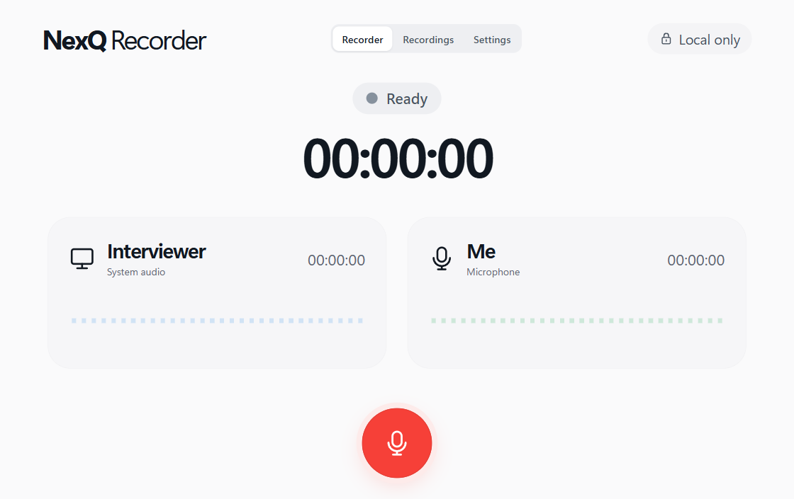

# NexQ Recorder

NexQ Recorder records Windows playback and microphone audio into two synchronized local WAV files. One button starts both tracks. Independent waveforms, timers, pause and resume, and bookmarks keep the recording controls in one place.



## Download and install

1. Open **Releases** and download the Windows x64 installer for the version you want to try. Run it and launch **NexQ Recorder** from the Start Menu. The installer also offers a desktop shortcut. [GitHub Releases](https://github.com/vincentlow02/forrecord/releases)
2. The installer includes Microsoft Edge WebView2 for offline setup. If you use the portable executable, put `LICENSE.txt` next to it and make sure the WebView2 Runtime is installed. [Microsoft Edge WebView2](https://developer.microsoft.com/microsoft-edge/webview2/)
3. Release-candidate executables are unsigned, so Windows SmartScreen may display a warning. The release includes SHA-256 checksums for both executables.

Windows 10 22H2 and Windows 11 x64 are the application targets. The desktop hardware check ran on Windows 11. See [validation results](docs/validation.md) for coverage.

## Record and find audio

- Open **Settings** to select the devices playing your call and capturing your voice. **Test devices** shows levels for up to 30 seconds without saving audio.
- In **Recorder**, click the red microphone to start. Use the side controls to pause, resume, or bookmark. **Stop and save** closes the session. **View Recording** opens that session in the library.
- In **Recordings**, search by name or sort by date or duration. Expand a row to preview Interviewer or Me with the built-in player, see bookmarks and capture details, or manage the session.
- **Export Interviewer** and **Export Me** each open Windows Save As for one WAV. **Export complete session** copies the two WAVs and the original metadata into a new folder at your chosen location. Exports leave the originals in place and require a free destination name.

## Local files and capture details

Recordings default to `%LOCALAPPDATA%\com.nexq.recorder\Recordings`. The current-user installer and default uninstall preserve that directory. Each session stores mono, 16-bit PCM at 16 kHz in `interviewer.wav` and `me.wav`. The two WAVs use about 230 MB per hour. Configuration and `session.json` remain on the computer. A synced or network folder may be copied by external software you configure.

The Interviewer track is the selected playback device's complete mix. Headphones help prevent the playback signal reaching the microphone. Pause time is excluded from both WAVs. When a device fails, the recorder reports the affected track and tries to save the audio already captured.

After a crash, open **Recordings** to recover playable data. Recovery preserves the longer valid track and extends the shorter one with silence when space allows. A session with one playable WAV remains accessible. Power loss can still lose data that never reached disk. Capture details distinguish driver reports, estimated timestamps, buffer drops, timeline padding, and overlap trimming. Earlier recordings remain readable.

NexQ works offline after the runtime is installed and starts capture only after you press Record or select the device test.

## Build from source

Install Node.js 24, Rust 1.100 with the `x86_64-pc-windows-msvc` target, Visual Studio Build Tools with **Desktop development with C++** and a Windows SDK, and the Microsoft Edge WebView2 Runtime. Use an x64 Developer PowerShell. [Tauri prerequisites](https://v2.tauri.app/start/prerequisites/)

```powershell
npm ci
npm run check
cargo test --release --locked --manifest-path src-tauri/Cargo.toml
npm run build
```

Tauri bundles the frontend directly from `ui/`. The build places `nexq-recorder.exe` under `src-tauri/target/release/` and the versioned installer under `src-tauri/target/release/bundle/nsis/`. Use `npm run tauri -- dev` for development. The Windows workflow packages, installs, smoke-tests, and checksums builds. [Windows builds](https://github.com/vincentlow02/forrecord/actions/workflows/windows.yml)

## Attribution

NexQ Recorder is MIT licensed. Its native-format WASAPI capture, silent render stream, downmix, and polyphase resampler are adapted from MeetRec by Mikhail Maksimov and contributors. It also follows MeetRec's streaming WAV writer and dedicated audio-worker architecture. [LICENSE](LICENSE) · [MeetRec source revision](https://github.com/mmaximov97/meeting-recorder/tree/41264c52b0e1c8efdd4c003b190bd0c57e479abc)
